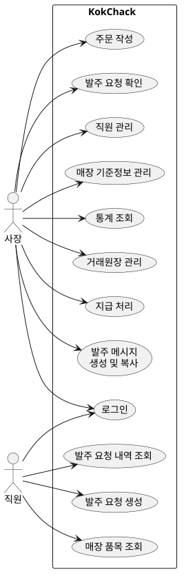
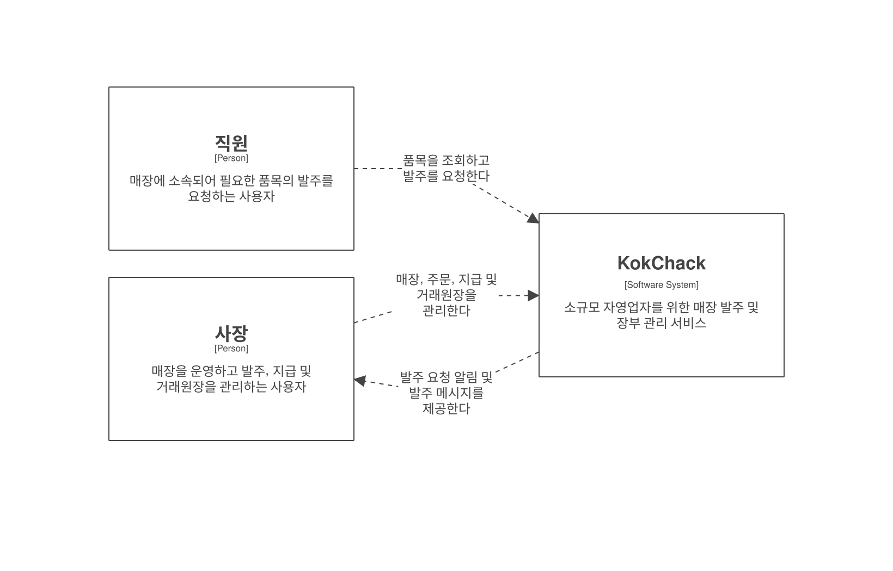
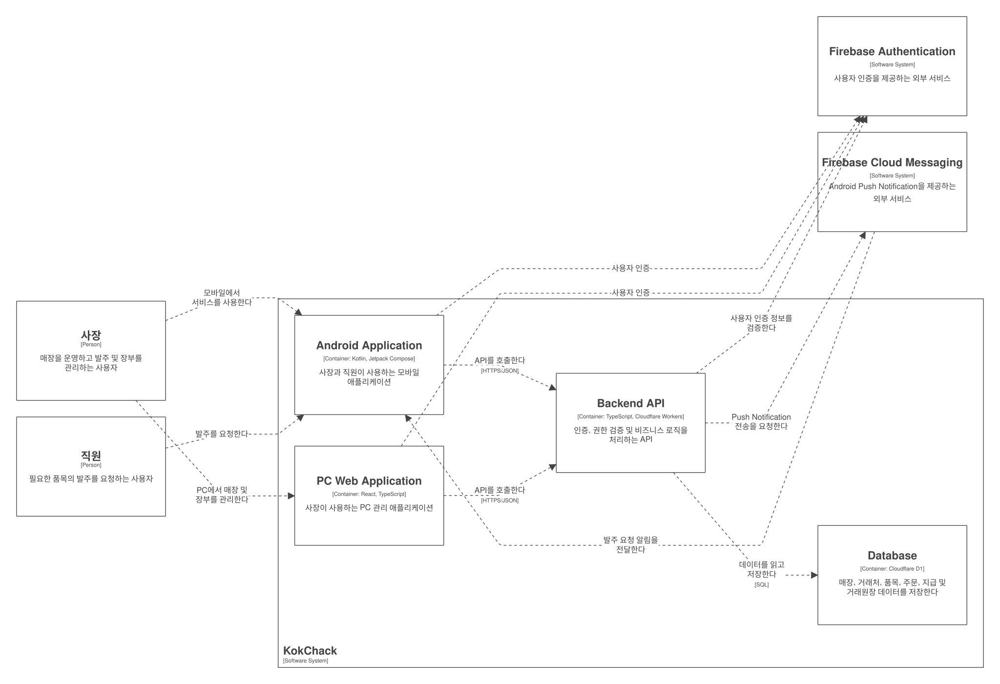

# Project Definition

## 1. Introduction

콕착(KokChack)은 소규모 자영업자를 위한 매장 발주 및 장부 관리 서비스입니다.

메시지, SNS, 이메일 등을 통해 거래처에 직접 발주하는 자영업자를 대상으로 하며,
거래처 및 품목 관리부터 발주, 지급 관리, 거래원장 및 통계까지 하나의 서비스에서 관리할 수 있도록 합니다.

직원은 Android 애플리케이션을 통해 필요한 품목의 발주를 사장에게 요청할 수 있으며,
사장은 해당 요청을 확인하고 거래처별 발주 메시지를 생성하여 기존 메시징 서비스를 통해 거래처에 전달할 수 있습니다.

사장은 Android 애플리케이션뿐만 아니라 PC Web을 통해 매장 기준정보, 주문, 지급, 거래원장 및 통계를 관리할 수 있습니다.

서비스는 아래 기능들을 제공합니다.

- 매장 및 구성원 관리
- 거래처, 품목, 보관 위치 등의 매장 기준정보 관리
- 직원의 발주 요청
- 직원의 발주 요청에 대한 사장 알림
- 거래처별 주문 작성
- 거래처별 발주 메시지 생성 및 복사
- 주문별 미지급·지급 관리
- 월별 품목 및 지급금액 통계 제공
- 거래원장 조회, 수정 및 삭제

### 1.1 Requirements Overview

사장은 콕착을 통해 매장 기준정보를 관리하고,
직원의 발주 요청 확인부터 거래처별 발주, 미지급·지급 관리, 통계 및 거래원장 관리까지 수행할 수 있습니다.

직원은 자신이 소속된 매장의 품목을 확인하고 사장에게 필요한 품목의 발주를 요청할 수 있습니다.

콕착은 거래처에 발주 메시지를 직접 전송하지 않으며,
사장이 생성된 발주 메시지를 복사하여 카카오톡, SMS, 이메일 등의 기존 메시징 서비스를 통해 직접 전달합니다.

---

## 2. Constraints

### 2.1 Technical Constraints

| ID  | Constraint                                                      | Background and/or Motivation                                                                         |
| --- | --------------------------------------------------------------- | ---------------------------------------------------------------------------------------------------- |
| TC1 | Android 애플리케이션은 Kotlin과 Jetpack Compose로 개발한다.     | 초기 사용 환경이 Android 중심이며 하나의 네이티브 모바일 플랫폼에 집중하기 위함이다.                 |
| TC2 | 사장용 PC 관리 화면은 Web Application으로 제공한다.             | 사장이 PC 환경에서 거래처, 품목, 주문, 지급 및 거래원장을 효율적으로 관리할 수 있도록 하기 위함이다. |
| TC3 | PC Web은 React와 TypeScript를 기반으로 개발한다.                | 컴포넌트 기반 UI 구성과 타입 안정성을 확보하기 위함이다.                                             |
| TC4 | Backend API는 Cloudflare Workers를 이용하여 구현한다.           | 별도의 애플리케이션 서버 운영 부담을 최소화하고 사용량 증가에 대응하기 위함이다.                     |
| TC5 | Backend는 TypeScript로 개발한다.                                | Cloudflare Workers 환경과의 호환성과 유지보수성을 확보하기 위함이다.                                 |
| TC6 | 주 데이터 저장소는 Cloudflare D1을 사용한다.                    | 매장, 거래처, 주문, 지급 등의 관계형 데이터를 SQL 기반으로 관리하기 위함이다.                        |
| TC7 | 사용자 인증은 Firebase Authentication을 이용한다.               | Android와 Web에서 공통된 인증 체계를 제공하기 위함이다.                                              |
| TC8 | 모바일 Push Notification은 Firebase Cloud Messaging을 이용한다. | 직원의 발주 요청을 사장에게 전달하기 위함이다.                                                       |
| TC9 | 사용자 권한은 매장 구성원 단위로 관리한다.                      | 하나의 사용자가 여러 매장에 서로 다른 역할로 참여할 수 있도록 하기 위함이다.                         |

### 2.2 Operational Constraints

| ID  | Constraint                                                                        | Background and/or Motivation                                     |
| --- | --------------------------------------------------------------------------------- | ---------------------------------------------------------------- |
| OC1 | 초기 서비스는 가능한 한 무료 사용 구간에서 운영할 수 있도록 구성한다.             | 초기 운영 비용을 최소화하기 위함이다.                            |
| OC2 | 애플리케이션 서버를 직접 운영하지 않고 관리형 서비스를 이용한다.                  | OS, 네트워크, 컨테이너 및 서버 장애 관리 부담을 줄이기 위함이다. |
| OC3 | 사용자 증가 시 기존 서비스 구조를 유지하면서 유료 플랜으로 확장할 수 있어야 한다. | Play Store 공개 이후 사용자 증가 가능성을 고려하기 위함이다.     |
| OC4 | 운영 데이터에 대한 백업 및 복구 방법을 마련해야 한다.                             | 장애 또는 운영 실수로 인한 데이터 손실에 대비하기 위함이다.      |
| OC5 | Android 애플리케이션은 Google Play를 통해 배포할 수 있어야 한다.                  | 일반 사용자가 서비스를 설치하고 사용할 수 있도록 하기 위함이다.  |

---

## 3. Context and Scope

### 3.1 Business Context

**사장 (Owner)**

사장은 매장을 생성하고 거래처, 품목, 보관 위치 등의 매장 기준정보를 관리합니다.

직원이 생성한 발주 요청을 확인하고 실제 주문으로 처리할 수 있으며,
거래처별 발주 메시지를 생성하여 기존 메시징 서비스를 통해 거래처에 직접 전달합니다.

또한 주문별 미지급·지급 상태를 관리하고 거래원장과 월별 통계를 조회할 수 있습니다.

사장은 Android 애플리케이션과 PC Web을 사용할 수 있습니다.

**직원 (Employee)**

직원은 자신이 소속된 매장의 제한된 정보를 조회하고 필요한 품목에 대한 발주 요청을 사장에게 전달할 수 있습니다.

직원은 거래처에 직접 발주하거나 지급, 거래원장 및 매장 기준정보를 관리하지 않습니다.

직원은 Android 애플리케이션을 사용합니다.

**거래처 (Supplier)**

거래처는 콕착의 직접적인 사용자가 아닙니다.

거래처는 사장이 콕착에서 생성한 발주 내용을 카카오톡, SMS, 이메일 등의 기존 메시징 서비스를 통해 전달받습니다.

### 3.2 System Context

### 3.3 Scope

#### In Scope

- 사용자 인증
- 매장 생성 및 관리
- 매장 구성원 및 역할 관리
- 직원 초대 및 매장 참여
- 매장별 거래처 관리
- 매장별 품목 관리
- 매장별 보관 위치 관리
- 직원의 발주 요청 생성
- 직원의 발주 요청 내역 조회
- 직원의 발주 요청에 대한 사장 Push Notification
- 사장의 발주 요청 확인
- 발주 요청을 기반으로 한 주문 작성
- 거래처별 주문 작성
- 거래처별 발주 메시지 생성
- 발주 메시지 클립보드 복사
- 주문별 미지급·지급 상태 관리
- 월별 품목 통계
- 월별 지급금액 통계
- 거래원장 조회, 수정 및 삭제
- 사장 및 직원용 Android 애플리케이션 제공
- 사장용 PC Web 관리 화면 제공

#### Out of Scope

- 외부 메시징 서비스 API를 이용한 거래처 자동 발송
- 거래처의 콕착 회원가입 및 서비스 직접 사용
- 실제 대금 결제
- 계좌이체
- 은행 API 연동
- 인터넷뱅킹 인증정보 관리
- 세금계산서 발행
- 회계 시스템 자동 연동
- ERP 시스템 자동 연동
- 배송 관리
- 재고 수량 자동 관리
- iOS 애플리케이션

---

## 4. Goals and Non-Goals

### 4.1 Goals

- 자영업자가 여러 거래처에 대한 발주 내용을 하나의 서비스에서 관리할 수 있도록 한다.
- 기존 메시징 서비스를 이용한 발주 방식을 유지하면서 발주 작성 과정을 단순화한다.
- 직원이 필요한 품목을 간단하게 사장에게 요청할 수 있도록 한다.
- 사장이 직원의 발주 요청을 빠르게 확인하고 실제 발주로 처리할 수 있도록 한다.
- 주문과 지급 내역을 기록하여 미지급 주문을 쉽게 확인할 수 있도록 한다.
- 월별 주문 및 지급 데이터를 통계 형태로 확인할 수 있도록 한다.
- 모바일과 PC에서 동일한 매장 데이터를 사용할 수 있도록 한다.
- 하나의 사용자가 여러 매장에 참여할 수 있도록 한다.
- 서비스 이용자가 증가하더라도 초기 시스템 구조를 크게 변경하지 않고 확장할 수 있도록 한다.
- 초기 운영 비용과 서버 관리 부담을 최소화한다.

### 4.2 Non-Goals

- 거래처가 콕착에 가입하여 주문을 직접 수신하는 시스템을 제공하지 않는다.
- 거래처에 카카오톡, SMS 또는 이메일을 자동 발송하지 않는다.
- 실제 결제 또는 계좌이체 기능을 제공하지 않는다.
- 은행 및 금융기관의 서비스를 대체하지 않는다.
- 재고 관리 시스템을 대체하는 것을 목표로 하지 않는다.
- 회계 또는 ERP 시스템을 대체하는 것을 목표로 하지 않는다.
- 초기 버전에서는 iOS 애플리케이션을 제공하지 않는다.

---

## 5. Non-Functional Requirements

### 5.1 Security

- 인증되지 않은 사용자는 매장 데이터에 접근할 수 없어야 한다.
- 사용자는 자신이 구성원으로 등록된 매장의 데이터에만 접근할 수 있어야 한다.
- 매장 내 기능 접근 권한은 사장과 직원의 역할에 따라 구분되어야 한다.
- 클라이언트에서 화면을 숨기는 것과 별개로 Backend API에서도 권한을 검증해야 한다.
- 다른 매장의 데이터가 사용자에게 노출되지 않도록 매장 단위 데이터 격리를 보장해야 한다.
- 인터넷뱅킹 비밀번호, 인증서, OTP 등의 금융 인증정보를 저장하지 않아야 한다.
- 인증 토큰 및 민감한 인증정보는 안전한 저장소를 이용하여 관리해야 한다.

### 5.2 Reliability

- 주문, 지급, 거래원장 및 매장 기준정보는 애플리케이션 종료 또는 재실행 후에도 유지되어야 한다.
- 운영 데이터는 백업을 통해 복구할 수 있어야 한다.
- Push Notification 전송 실패 여부와 관계없이 직원의 발주 요청 데이터 자체는 저장되어야 한다.
- 외부 알림 서비스에 일시적인 장애가 발생하더라도 저장된 발주 요청은 이후 애플리케이션에서 확인할 수 있어야 한다.

### 5.3 Performance

- 일반적인 매장 정보 및 거래원장 조회는 실제 업무에 지장을 주지 않는 수준의 응답 시간을 제공해야 한다.
- 모바일 화면에서 불필요한 전체 데이터 조회를 피하고 필요한 범위의 데이터만 요청해야 한다.
- 데이터 조회에 사용되는 주요 조건에 적절한 데이터베이스 인덱스를 적용해야 한다.
- 정량적인 성능 기준은 초기 실제 사용 데이터를 수집한 이후 구체화한다.

### 5.4 Maintainability

- 클라이언트 UI, Backend API 및 데이터 저장소의 책임을 분리한다.
- 핵심 비즈니스 로직은 외부 인터페이스와 분리하여 자동화 테스트가 가능하도록 구성한다.
- 사용자 권한 검증 로직은 일관된 방식으로 적용할 수 있어야 한다.
- Android와 PC Web은 동일한 Backend API를 사용한다.
- 외부 서비스에 대한 의존성을 명확하게 분리하여 향후 서비스 교체가 가능하도록 구성한다.

### 5.5 Usability

- 직원은 최소한의 화면 이동으로 발주 요청을 생성할 수 있어야 한다.
- 사장은 모바일에서 새로운 발주 요청을 쉽게 확인할 수 있어야 한다.
- 자주 사용하는 발주 및 지급 업무는 모바일 환경에서도 수행할 수 있어야 한다.
- 대량의 기준정보 및 거래원장 관리는 PC Web에서 효율적으로 수행할 수 있어야 한다.
- 발주 메시지와 계좌번호 등 외부 애플리케이션에서 사용할 정보는 쉽게 복사할 수 있어야 한다.

---

## 6. Definition of Done

콕착의 1차 개발 범위는 다음 조건을 만족하면 완료된 것으로 판단한다.

### Account and Store

- 사용자가 회원가입 및 로그인할 수 있다.
- 사용자가 매장을 생성할 수 있다.
- 사장이 직원을 자신의 매장에 참여시킬 수 있다.
- 사장과 직원의 권한에 따라 사용할 수 있는 기능이 구분된다.
- 사용자가 자신이 접근 권한을 가진 매장의 데이터에만 접근할 수 있다.

### Android Application

- 사장과 직원이 Android 애플리케이션에서 로그인할 수 있다.
- 역할에 따라 서로 다른 기능과 화면이 제공된다.
- 직원이 필요한 품목을 선택하여 사장에게 발주를 요청할 수 있다.
- 발주 요청 발생 시 사장이 Push Notification을 받을 수 있다.
- 사장이 발주 요청을 확인할 수 있다.
- 사장이 발주 요청을 기반으로 주문을 작성할 수 있다.
- 사장이 거래처별 발주 메시지를 생성하고 복사할 수 있다.
- 사장이 주문의 지급 및 미지급 상태를 확인하고 변경할 수 있다.
- 사장이 기본적인 거래원장 정보를 조회할 수 있다.

### PC Web

- 사장이 PC Web에 로그인할 수 있다.
- 사장이 거래처를 조회, 생성, 수정 및 삭제할 수 있다.
- 사장이 품목을 조회, 생성, 수정 및 삭제할 수 있다.
- 사장이 보관 위치를 조회, 생성, 수정 및 삭제할 수 있다.
- 사장이 주문 내역을 관리할 수 있다.
- 사장이 지급 상태를 관리할 수 있다.
- 사장이 거래원장을 조회, 수정 및 삭제할 수 있다.
- 사장이 월별 품목 및 지급금액 통계를 확인할 수 있다.

### Backend and Operation

- Android와 PC Web이 동일한 Backend API와 데이터를 사용한다.
- 주요 Backend API에서 인증 및 권한 검사가 수행된다.
- 주요 도메인 로직에 대한 자동화 테스트가 존재한다.
- 서비스가 Cloudflare 기반 환경에 배포되어 실제 외부 환경에서 사용할 수 있다.
- Android 애플리케이션을 Google Play를 통해 배포할 수 있다.
- 운영 데이터의 백업 및 복구 방법이 문서화되어 있다.

---

## 7. Risks

- Cloudflare 또는 Firebase의 무료 사용량 및 가격 정책이 변경될 수 있다.
- 서비스 이용자가 증가할 경우 무료 사용량을 초과하여 운영 비용이 발생할 수 있다.
- Cloudflare 또는 Firebase 장애 발생 시 서비스 일부 또는 전체 기능을 사용할 수 없을 수 있다.
- Firebase Cloud Messaging 장애 또는 Android 운영체제 정책에 따라 Push Notification이 지연되거나 전달되지 않을 수 있다.
- 매장별 사용자와 권한 관리가 올바르게 구현되지 않을 경우 다른 매장의 데이터가 노출될 위험이 있다.
- 공개 서비스로 운영되는 경우 인증, 권한 및 API 악용에 대한 추가적인 보안 대응이 필요할 수 있다.
- 주문, 지급 및 거래원장 간 데이터 모델이 복잡해질 가능성이 있다.
- 외부 메시징 서비스를 직접 연동하지 않으므로 사장이 발주 메시지를 별도로 복사하여 전달해야 한다.
- Cloudflare 및 Firebase에 대한 의존성이 증가할 경우 향후 다른 플랫폼으로 이전하는 비용이 발생할 수 있다.

---

## 8. Open Issues

- 직원에게 허용할 거래처 및 품목 정보의 구체적인 조회 범위
- 직원 초대 방식을 초대 코드, 링크 또는 다른 방식 중 무엇으로 제공할지 여부
- 직원이 자신의 과거 발주 요청을 어느 범위까지 조회할 수 있도록 할지 여부
- 발주 메시지 템플릿을 사용자가 직접 수정할 수 있도록 할지 여부
- 거래처별로 서로 다른 발주 메시지 템플릿을 지원할지 여부
- 주문이 생성된 이후 수정 가능한 시점을 제한할지 여부
- 주문 취소 기능 및 취소 상태를 별도로 제공할지 여부
- 지급의 부분 지급을 지원할지 여부
- 하나의 사장이 생성하거나 관리할 수 있는 매장 수를 제한할지 여부
- 사장용 Android 애플리케이션과 PC Web 간의 구체적인 기능 범위 차이
- 거래원장 데이터의 보관 기간을 제한할지 여부
- 계정 탈퇴 및 매장 삭제 시 기존 주문 및 거래원장 데이터를 어떻게 처리할지 여부
